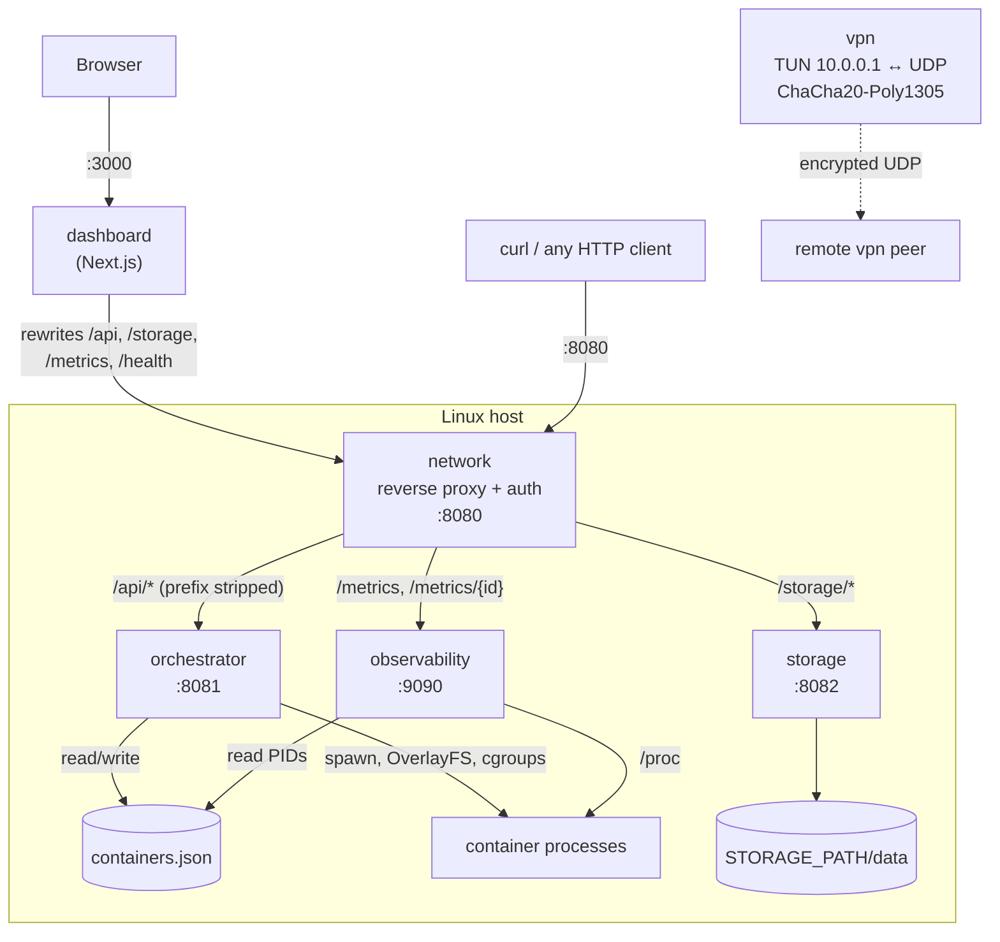
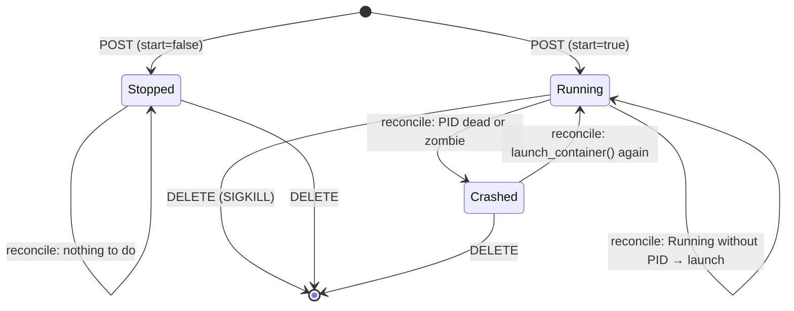

# my-cloud

A minimal cloud provider written from scratch in Rust: a reverse proxy, a
container orchestrator, an S3-style object store, a metrics service, an
encrypted VPN tunnel, and a Next.js dashboard. Everything is built on the
standard library and a few small crates. There is no web framework, no async
runtime, and no Docker. HTTP parsing, process supervision, cgroups and the
tunnel are all implemented here.

The goal is educational: each component is small enough to read in one sitting
and shows how the corresponding piece of a real cloud works underneath.

---

## Table of contents

1. [Architecture overview](#architecture-overview)
2. [Repository layout](#repository-layout)
3. [Life of a request](#life-of-a-request)
4. [The `common` crate](#the-common-crate)
5. [Services in depth](#services-in-depth)
   - [network: the reverse proxy and API gateway](#network-the-reverse-proxy-and-api-gateway)
   - [orchestrator: container management](#orchestrator-container-management)
   - [storage: the object store](#storage-the-object-store)
   - [observability: metrics](#observability-metrics)
   - [vpn: the encrypted tunnel](#vpn-the-encrypted-tunnel)
   - [runtime: standalone launcher](#runtime-standalone-launcher)
   - [dashboard: the web UI](#dashboard-the-web-ui)
6. [Configuration](#configuration)
7. [Getting started](#getting-started)
8. [API reference](#api-reference)
9. [Concurrency model](#concurrency-model)
10. [Known limitations](#known-limitations)
11. [Troubleshooting](#troubleshooting)

---

## Architecture overview



Each service is a separate binary that runs as its own process. They share
code through the `common` library crate. Every service speaks plain
HTTP/1.1 over TCP. The proxy is the single public entry point. It checks the
API token and forwards each request to the right backend based on the URL
prefix. The orchestrator and the observability service never talk to each
other directly: they share state through the `containers.json` file.

| Service         | Default address  | Role                                                   | Needs root?                   |
|-----------------|------------------|--------------------------------------------------------|-------------------------------|
| `network`       | `0.0.0.0:8080`   | Public entry point: routing, bearer-token auth, CORS   | No                            |
| `orchestrator`  | `0.0.0.0:8081`   | Container CRUD, process supervision, auto-restart      | Only to *start* containers    |
| `storage`       | `0.0.0.0:8082`   | Key/value object store on the local filesystem         | No                            |
| `observability` | `0.0.0.0:9090`   | Host metrics and per-container CPU/memory              | No                            |
| `vpn`           | UDP `9998/9999`  | Point-to-point encrypted tunnel over a TUN interface   | Yes (creates a TUN device)    |
| `runtime`       | none             | Demo binary that launches one container                | Yes                           |
| `dashboard`     | `localhost:3000` | Web UI (Next.js 16, React 19, Tailwind 4)              | No                            |

---

## Repository layout

```
my-cloud/
├── Cargo.toml            # Cargo workspace (all Rust crates below)
├── start.sh              # Build + launch every service and the dashboard
├── .env.example          # Configuration template (copy to .env)
│
├── common/               # Shared library crate
│   └── src/
│       ├── lib.rs        # Module declarations
│       ├── error.rs      # CloudError + Result<T> alias
│       ├── http.rs       # Hand-written HTTP/1.1 parser, responses, auth
│       ├── models.rs     # Container, Metrics, ObjectStore, repositories, builder
│       └── container.rs  # OverlayFS, cgroups, spawn / liveness / kill
│
├── network/src/main.rs        # Reverse proxy
├── orchestrator/src/main.rs   # Container API + reconciliation loop
├── storage/src/main.rs        # Object store HTTP API
├── observability/src/main.rs  # /proc-based metrics
├── vpn/src/main.rs            # TUN ↔ encrypted UDP tunnel
├── runtime/src/main.rs        # One-shot container launcher (demo)
│
└── dashboard/            # Next.js front-end
    ├── next.config.ts    # Rewrites browser requests to the proxy
    ├── lib/              # API client, config, TypeScript types
    ├── hooks/            # Polling data hooks (useContainers, useMetrics…)
    ├── components/       # Navbar, cards, animated hero
    └── app/              # Pages: /, /containers, /containers/[id], /storage
```

---

## Life of a request

Here is what happens when you create a container from the dashboard.

1. **Browser → Next.js.** The page calls `createContainer()` in
   `dashboard/lib/api.ts`, which sends `POST /api/containers` with a JSON body
   and `Authorization: Bearer <NEXT_PUBLIC_API_TOKEN>`. `NEXT_PUBLIC_API_URL` is
   empty by default, so the URL is relative and goes to the Next.js server
   itself.
2. **Next.js → proxy.** `next.config.ts` has a rewrite rule
   `/api/:path* → http://localhost:8080/api/:path*`. Next.js forwards the
   request server-side. Node.js sends header names in lowercase
   (`authorization`, `content-length`), which is why the HTTP parser treats
   header names case-insensitively.
3. **Proxy.** `network` accepts the TCP connection and hands it to a new thread,
   which calls `parse_request`. `is_protected("POST", "/api/containers")`
   returns `true`, so `check_auth` compares the bearer token with `API_TOKEN`.
   If the token is wrong, the proxy answers `401` itself. Otherwise the `/api`
   prefix is stripped and the request is forwarded to the orchestrator as
   `POST /containers`.
4. **Forwarding.** `forward_request` opens a new TCP connection to the
   backend. It writes a fresh request line, the `Host`, `Content-Type`,
   `Content-Length` and `Connection: close` headers, and the body. It then reads
   the backend's whole response (`read_to_end`, which ends when the backend
   closes the socket) and copies the raw bytes back to the client.
5. **Orchestrator.** The handler parses the JSON, builds a `Container` with
   `ContainerBuilder` (which assigns a UUID v4), and saves it to
   `containers.json` with status `Stopped`. If `"start": true`, it calls
   `launch_container`, which mounts the OverlayFS, spawns the process, and
   attaches the process to the cgroups. It then records the PID and the
   `Running` status, and returns `201 Created` with the up-to-date container
   as JSON.
6. **Back to the browser.** The response travels back through the proxy and
   Next.js. The `useContainers` hook calls `load()` again, and the list
   refreshes.

From then on, the orchestrator's **reconciliation loop** checks every 5 seconds
that the process is still alive and restarts it if it is not.

---

## The `common` crate

All services depend on `common`. It holds everything that would otherwise be
duplicated across them.

### `error.rs`: one error type for the whole project

```rust
pub enum CloudError { Io(..), Parse(String), NotFound(String), Json(..), Nix(..), Crypto(String) }
pub type Result<T> = std::result::Result<T, CloudError>;
```

`From` implementations for `std::io::Error`, `serde_json::Error` and
`nix::Error` let any of these be propagated with `?`. `Display` produces
human-readable messages. `Debug` reuses `Display`, so that a `main()` that
returns an error prints a readable message.

### `http.rs`: a hand-written HTTP/1.1 server toolkit

There is no HTTP library. The protocol is handled directly on the `TcpStream`.

- **`parse_request(&TcpStream) -> HttpRequest`**
  1. Reads the request line (`METHOD PATH VERSION`) through a `BufReader`.
  2. Reads header lines until the empty line. Header **names are lowercased**,
     because HTTP header names are case-insensitive and different clients
     (curl compared with Node.js) use different casing.
  3. If a `content-length` header is present, reads exactly that many bytes of
     body with `read_exact`. Chunked transfer encoding is not supported.
- **`send_response(stream, status, body)`** writes a complete response with
  `Content-Type: application/json`, the exact `Content-Length`, and permissive
  CORS headers (`Access-Control-Allow-Origin: *`, the allowed methods, and the
  `Authorization` and `Content-Type` headers). Each connection serves exactly
  one request, and the socket is closed when the handler's `TcpStream` is
  dropped.
- **`send_error(stream, &CloudError)`** maps an error to a status code:
  `Parse`/`Json` give `400`, `NotFound` gives `404`, anything else gives `500`.
  Every service calls it when its handler fails, so a client always gets an
  answer instead of a connection that closes with no response.
- **`check_auth(req, token)`** checks for `authorization: Bearer <token>`.
- **`is_protected(method, path)`** defines the authorization policy:

  | Request                          | Token required? |
  |----------------------------------|-----------------|
  | `OPTIONS *` (CORS preflight)     | no              |
  | `* /health`, `* /metrics`        | no              |
  | `GET *`                          | no              |
  | anything else (POST/PUT/DELETE…) | **yes**         |

  Reads are public and writes need the token.

### `models.rs`: data model and persistence

- **`Container`**: `{ id, name, image, args, status, pid }`. `image` is the
  path to an executable on the host, such as `/bin/sleep`. It is not an OCI
  image. `status` is one of `Running`, `Stopped`, `Crashed`, serialized as
  those exact strings.
- **`ContainerBuilder`** uses the builder pattern. `name` and `image` are
  required. `build()` assigns a random UUID and starts in `Stopped` with no
  PID.
- **`ContainerRepository`** (a trait, `Send + Sync`) defines `add`, `list`,
  `get`, `delete`, `update_status` and `update_pid`. It has two
  implementations:
  - `InMemoryRepository`: a `Mutex<Vec<Container>>`, useful for tests and
    experiments.
  - `FileRepository`: the one used in practice. The whole container list is
    stored as pretty-printed JSON in a single file (`CONTAINERS_FILE`). Each
    operation loads the file, changes the list, and saves it. An internal
    `Mutex<()>` makes these load → change → save cycles atomic across the
    orchestrator's threads, so the HTTP threads and the reconciliation thread
    cannot overwrite each other's changes. The file survives restarts, so the
    orchestrator keeps its state, and the observability service can read it
    too.
- **`ObjectStore`**: the storage backend. Objects are files at
  `<base_path>/data/<key>`. Keys must be flat names: empty keys, `.`, `..`, and
  keys containing `/`, `\` or NUL are rejected, so a key can never reach
  outside the data directory (path traversal). A `meta/` directory is created
  for future metadata but is not used yet.
- **`Metrics`**: `{ cpu_usage, memory_used, memory_total, uptime_secs }`.
  Memory values are in KiB, as read from `/proc/meminfo`.

### `container.rs`: the container "runtime"

This file turns a `Container` into a running Linux process.

- **`setup_overlay(base)`** creates `lower/`, `upper/`, `work/` and `merged/`
  under `/var/my-cloud/containers/<id>/` and mounts an **OverlayFS** on
  `merged/`. In an overlay, reads come from `lower` and writes land in `upper`.
  This is copy-on-write, the same idea Docker uses for image layers. The mount
  is skipped if `merged/` is already listed in `/proc/mounts`, so a restarted
  container does not stack a second overlay. Mounting requires
  `CAP_SYS_ADMIN`, which in practice means root.
- **`setup_cgroup(id, pid)`** creates the `my-container-<id>` group under the
  **cgroup v1** `memory`, `cpu` and `pids` hierarchies and sets these limits:
  - `memory.limit_in_bytes = 536870912`, a 512 MiB memory cap.
  - `cpu.cfs_quota_us = 50000` with `cpu.cfs_period_us = 100000`, which caps
    the container at 50 % of one CPU.

  It then writes the PID into the memory and cpu groups' `cgroup.procs`. The
  pids group is created but no limit is set yet.
- **`launch_container(container)`** runs `setup_overlay`, spawns
  `image args…` with stdin/stdout/stderr redirected to `/dev/null`, and then
  calls `setup_cgroup`. It returns the PID.
- **`is_alive(pid)`** reads `/proc/<pid>/stat` and looks at the state field
  (the first field after the `)` that closes the command name). A missing file
  means the process is dead. State `Z` (zombie) also means dead. A zombie is a
  child that has exited but that its parent has never `wait()`ed for. It still
  appears in `/proc`, so checking only that `/proc/<pid>` exists would never
  detect a crash. `is_alive` also reaps the zombie with
  `waitpid(WNOHANG)`. Unit tests cover both the zombie case and the alive case.
- **`stop_container(pid)`** sends `SIGKILL`, ignoring `ESRCH` (the process is
  already gone), and reaps the process.

> **Isolation level.** This is a teaching runtime. Processes are limited with
> cgroups, but they are **not** placed in new namespaces (PID, mount, network,
> UTS…), and they are **not** chrooted into the overlay's `merged/` directory.
> They run with the host's filesystem and network. The `nix` features `sched`
> and `hostname` are already enabled, for when `unshare`/`clone` and
> `pivot_root` are added.

---

## Services in depth

### network: the reverse proxy and API gateway

`network/src/main.rs`

**Main loop.** It binds `NETWORK_ADDR`, and for each incoming connection it
clones the configuration strings and spawns one OS thread that runs
`handle_connection`. A slow backend therefore never blocks other clients.

**Routing table** (evaluated in this order):

| Incoming path               | Action                                                   |
|-----------------------------|----------------------------------------------------------|
| any `OPTIONS`               | `200 OK` with CORS headers (preflight)                   |
| `/health`                   | `200 OK`, answered by the proxy itself                   |
| `/metrics`, `/metrics/…`    | forwarded unchanged to `OBSERVABILITY_ADDR`              |
| `/api…`                     | `/api` prefix **stripped**, forwarded to `ORCHESTRATOR_ADDR` |
| `/storage…`                 | forwarded unchanged to `STORAGE_ADDR`                    |
| `/dashboard…`               | prefix stripped, forwarded to `DASHBOARD_ADDR`           |
| anything else               | `404 Not Found`                                          |

Authentication (`is_protected` and `check_auth`) runs **before** routing, so
backends never see unauthenticated write requests. The backends do not check
the token themselves, which means they must not be reachable from outside.
That is why `.env.example` binds them to `127.0.0.1`.

**`forward_request`** works like a tiny HTTP client:

```
METHOD <path> HTTP/1.1
Host: <backend>
Content-Type: <copied from client, if any>
Content-Length: <body length>
Connection: close
<body>
```

`Connection: close` is required. The proxy reads the response with
`read_to_end`, which returns only when the backend closes the socket. The Rust
services close after every response anyway, but a keep-alive server such as the
Next.js dev server would otherwise hang the proxy. The response bytes (status
line, headers and body) are copied back to the client unchanged. If the backend
cannot be reached, the proxy answers `502 Bad Gateway` and logs which service
is down.

> Despite older notes, there is **no load balancing**: each prefix maps to
> exactly one backend address.

### orchestrator: container management

`orchestrator/src/main.rs`

On startup it:

1. Loads `.env` with `dotenvy`.
2. Opens (or creates, with `[]`) the `FileRepository` at `CONTAINERS_FILE`.
   The repository is shared as `Arc<dyn ContainerRepository + Send + Sync>`.
3. Starts the **reconciliation thread**.
4. Accepts HTTP connections, one thread each.

**HTTP API** (paths as seen by the orchestrator, behind the proxy's `/api`
prefix):

| Method & path        | Behaviour                                                                                   |
|----------------------|---------------------------------------------------------------------------------------------|
| `POST /containers`   | Body `{name, image, args?, start?}`. Creates the container. If `start`, launches it. Returns `201` with the container. |
| `GET /containers`    | Returns the JSON array of all containers.                                                   |
| `DELETE /containers/{id}` | `404` if unknown. Otherwise marks it `Stopped`, `SIGKILL`s its PID, then removes it. |

If `start: true` fails, for example because the orchestrator is not running as
root (`EPERM` on the overlay mount), the container stays saved as `Stopped`
and the client gets a `500` with the error message.

**Reconciliation loop**: the core idea behind Kubernetes-style controllers.
Every 5 seconds it compares the *desired* state stored in `containers.json`
with the *actual* state of the system and corrects any difference:



- `Running` with a PID that `is_alive` reports dead → marked `Crashed`.
- `Crashed` → relaunched through `launch_container`, with the same args,
  overlay and cgroups as the first launch. The new PID is saved and the
  status goes back to `Running`.
- `Running` without a PID → launched.
- `Stopped` → left alone.

The restart policy is therefore "always". A program that exits right away will
be relaunched every 5 seconds.

`DELETE` first switches the container to `Stopped` so that the reconciliation
loop cannot restart it between the kill and the removal.

### storage: the object store

`storage/src/main.rs`

An S3-like key/value store. Data lives under `STORAGE_PATH` (default
`/tmp/my-storage`), with one file per key in `data/`.

| Method & path         | Behaviour                                                        |
|-----------------------|------------------------------------------------------------------|
| `PUT /storage/{key}`  | Writes the request body as the object. `201`, body is the key.   |
| `GET /storage`        | JSON array of all keys.                                          |
| `GET /storage/{key}`  | Object content, or `404`.                                        |
| `DELETE /storage/{key}` | Removes the object. `404` if it does not exist.                |
| invalid key (`..`, `/`…) | `400 Bad Request`                                             |

The `ObjectStore` is shared between request threads through an `Arc`. Each
operation is a single filesystem call, so no lock is needed.

### observability: metrics

`observability/src/main.rs`

Everything is read from the Linux `/proc` pseudo-filesystem.

**`GET /metrics`** returns the host metrics:

| Field          | Source & computation                                                                                         |
|----------------|--------------------------------------------------------------------------------------------------------------|
| `cpu_usage`    | `/proc/stat`, aggregated `cpu` line, sampled twice 100 ms apart: `(Δtotal − Δ(idle+iowait)) / Δtotal × 100`. The counters are cumulative since boot, so the difference between two samples is what gives the *current* usage. |
| `memory_total` | `MemTotal` from `/proc/meminfo` (KiB)                                                                        |
| `memory_used`  | `MemTotal − MemAvailable` (KiB)                                                                              |
| `uptime_secs`  | First number in `/proc/uptime`                                                                               |

**`GET /metrics/{container_id}`** returns metrics for one container:

1. Looks up the container's PID in `CONTAINERS_FILE` (the same file the
   orchestrator writes).
2. **CPU %**: reads `utime + stime` (fields 14 and 15 of `/proc/<pid>/stat`)
   and the total jiffies from `/proc/stat`, waits 100 ms, reads both again,
   and computes `Δprocess / Δtotal × 100`. The result is a share of the whole
   machine, all cores included.
3. **Memory**: `VmRSS` from `/proc/<pid>/status`, in KiB.

It returns `{container_id, pid, cpu_percent, memory_rss_kb}`, or `404` if the
container is unknown, has no PID, or its process no longer exists.

### vpn: the encrypted tunnel

`vpn/src/main.rs`

A minimal point-to-point VPN, in the spirit of WireGuard but much simpler.

1. Creates a **TUN** interface (`VPN_TUN_ADDR`, default `10.0.0.1/24`). The
   kernel routes IP packets for that subnet into the interface, and the
   program reads them as raw bytes.
2. Splits the device into a reader and a writer, and binds two UDP sockets:
   `VPN_SEND_ADDR` for sending and `VPN_RECV_ADDR` for receiving.
3. **Outbound thread (main)**: TUN read → encrypt → `send_to(VPN_DEST_ADDR)`.
4. **Inbound thread**: `recv_from` → decrypt → write to TUN, which injects the
   packet into the local network stack.

**Wire format** of each UDP datagram:

```
+----------------+------------------------------------+
| nonce (12 B)   | ChaCha20-Poly1305 ciphertext + tag |
| random, clear  | (IP packet length + 16 bytes)      |
+----------------+------------------------------------+
```

ChaCha20-Poly1305 is an AEAD cipher: it encrypts the packet and authenticates
it, so a tampered packet fails to decrypt and is dropped. A **fresh random
96-bit nonce** is generated for every packet and sent in the clear. ChaCha20
must never reuse a nonce with the same key. A per-peer counter would repeat,
because both peers share the key and counters reset when the process
restarts. Random nonces avoid this, and they also tolerate lost or reordered
UDP packets.

The 32-byte key comes from `VPN_KEY` as 64 hex characters (generate one with
`openssl rand -hex 32`). If `VPN_KEY` is not set, the program uses a fixed demo
key and prints a warning.

To link two machines, run `vpn` on both with the same `VPN_KEY`, different
`VPN_TUN_ADDR` values (`10.0.0.1` and `10.0.0.2`), and each peer's
`VPN_DEST_ADDR` pointing to the other's `VPN_RECV_ADDR`. Then
`ping 10.0.0.2` from the first machine.

### runtime: standalone launcher

`runtime/src/main.rs` builds a container for `/bin/sh` and runs it once with
`launch_container`. It is a quick way to try the OverlayFS and cgroup code
without the orchestrator (`sudo ./target/debug/runtime`).

### dashboard: the web UI

`dashboard/`: Next.js 16 (App Router), React 19, Tailwind CSS 4, and
`next-themes` for light and dark mode.

**How it reaches the backend.** All pages are client components (`"use client"`).
`lib/config.ts` reads `NEXT_PUBLIC_API_URL`, which defaults to empty and
therefore gives relative URLs, and `NEXT_PUBLIC_API_TOKEN`. Requests to
`/api/*`, `/storage/*`, `/metrics*` and `/health` are rewritten by
`next.config.ts` to the proxy on `localhost:8080`. The browser only ever talks
to its own origin, so it never makes a cross-origin (CORS) request.

**Layers:**

| Layer         | Files                                   | Responsibility |
|---------------|-----------------------------------------|----------------|
| Types         | `lib/types.ts`                          | TypeScript mirrors of the Rust structs (`Container`, `Metrics`, `ContainerMetrics`). |
| API client    | `lib/api.ts`                            | One `fetch` wrapper per endpoint. It throws on non-2xx responses. |
| Data hooks    | `hooks/use*.ts`                         | `useContainers`, `useStorage`, `useMetrics`, `useContainerMetrics`. Each one keeps `data/loading/error` state, **polls every 5 s** (`setInterval` in `useEffect`), and exposes mutations (`create`, `remove`, `upload`) that refetch afterwards. |
| Components    | `components/*.tsx`                      | `Navbar` (links, health indicator that polls `/health` every 10 s, theme toggle), `ContainerCard`, `MetricsCard`, `MetaballHero` (canvas animation). |
| Pages         | `app/page.tsx`                          | Overview: host metrics, container counts by status, recent containers and files. |
|               | `app/containers/page.tsx`               | Full list, status filters, creation form. |
|               | `app/containers/[id]/page.tsx`          | Container details and live CPU/RSS. |
|               | `app/storage/page.tsx`                  | File grid, text upload form, delete. |

> `NEXT_PUBLIC_*` variables are embedded into the JavaScript sent to the
> browser, so anyone who can open the dashboard can read the API token. That
> is fine for a local demo, but not for a public deployment.

---

## Configuration

Every Rust service calls `dotenvy::dotenv()` at startup. It loads `.env` from
the current directory, and variables already set in the environment take
precedence. Copy `.env.example` to `.env` and edit it.

| Variable              | Used by                          | Default                          | Meaning |
|-----------------------|----------------------------------|----------------------------------|---------|
| `API_TOKEN`           | network                          | `secret`                         | Bearer token required for write requests. **Change it.** |
| `NETWORK_ADDR`        | network                          | `0.0.0.0:8080`                   | Proxy listen address. |
| `ORCHESTRATOR_ADDR`   | orchestrator (listen), network (target) | `0.0.0.0:8081` / `127.0.0.1:8081` | |
| `STORAGE_ADDR`        | storage, network                 | `0.0.0.0:8082` / `127.0.0.1:8082` | |
| `OBSERVABILITY_ADDR`  | observability, network           | `0.0.0.0:9090` / `127.0.0.1:9090` | |
| `DASHBOARD_ADDR`      | network                          | `127.0.0.1:3000`                 | Target for `/dashboard…`. |
| `CONTAINERS_FILE`     | orchestrator, observability      | `/var/my-cloud/containers.json`  | Container state file. |
| `STORAGE_PATH`        | storage                          | `/tmp/my-storage`                | Object store root. |
| `VPN_TUN_ADDR`        | vpn                              | `10.0.0.1`                       | Local tunnel IP. |
| `VPN_SEND_ADDR`       | vpn                              | `0.0.0.0:9998`                   | UDP socket used to send. |
| `VPN_RECV_ADDR`       | vpn                              | `0.0.0.0:9999`                   | UDP socket used to receive. |
| `VPN_DEST_ADDR`       | vpn                              | `127.0.0.1:9999`                 | Remote peer's receive address. |
| `VPN_KEY`             | vpn                              | demo key                         | 64 hex characters (32-byte key). |

Dashboard (`dashboard/.env.local`):

| Variable                 | Meaning |
|--------------------------|---------|
| `NEXT_PUBLIC_API_TOKEN`  | Must match `API_TOKEN`. |
| `NEXT_PUBLIC_API_URL`    | Optional. Leave empty to use the Next.js rewrites. |

`/var/my-cloud` must exist and be writable by the user running the
orchestrator:

```bash
sudo mkdir -p /var/my-cloud && sudo chown "$USER" /var/my-cloud
```

---

## Getting started

### Prerequisites

- Linux. The project depends on `/proc`, OverlayFS, cgroup **v1** and TUN.
  Ubuntu 20.04 works out of the box. On cgroup v2 systems (Ubuntu 22.04+),
  starting containers fails until `setup_cgroup` is ported to v2.
- Rust 1.85+ (the crates use edition 2024).
- Node.js 20+ and npm (for the dashboard).
- `sudo` for starting containers and for the VPN.

### Run everything

```bash
cp .env.example .env              # then edit API_TOKEN
echo "NEXT_PUBLIC_API_TOKEN=<same token>" > dashboard/.env.local
./start.sh
```

`start.sh` builds the workspace in release mode, installs the dashboard's npm
dependencies if they are missing, and starts observability, storage,
orchestrator, network and the dashboard. **Ctrl+C** stops all of them: the
trap signals the whole process group, including Next.js.

| URL                              | What                     |
|----------------------------------|--------------------------|
| http://localhost:3000            | Dashboard                |
| http://localhost:8080/health     | Proxy health check       |
| http://localhost:8080/metrics    | Host metrics             |

### Run services individually

```bash
cargo build --workspace
cargo run -p observability
cargo run -p storage
cargo run -p network
sudo -E ./target/debug/orchestrator   # root is needed for start=true
sudo -E ./target/debug/vpn            # optional
cd dashboard && npm install && npm run dev
```

### Tests

```bash
cargo test --workspace
cargo clippy --workspace
cd dashboard && npx tsc --noEmit && npm run lint
```

---

## API reference

All examples go through the proxy on `:8080`. Replace `$TOKEN` with your
`API_TOKEN`.

### Containers

```bash
# Create (and start) a container
curl -X POST http://localhost:8080/api/containers \
  -H "Authorization: Bearer $TOKEN" \
  -H "Content-Type: application/json" \
  -d '{"name":"sleeper","image":"/bin/sleep","args":["3600"],"start":true}'
# → 201 {"id":"…","name":"sleeper","image":"/bin/sleep","args":["3600"],"status":"Running","pid":12345}

# List containers
curl http://localhost:8080/api/containers

# Delete a container (kills its process)
curl -X DELETE http://localhost:8080/api/containers/<id> \
  -H "Authorization: Bearer $TOKEN"
```

### Storage

```bash
curl -X PUT http://localhost:8080/storage/hello.txt \
  -H "Authorization: Bearer $TOKEN" --data-binary "Hello, cloud"
curl http://localhost:8080/storage            # ["hello.txt"]
curl http://localhost:8080/storage/hello.txt  # Hello, cloud
curl -X DELETE http://localhost:8080/storage/hello.txt -H "Authorization: Bearer $TOKEN"
```

### Metrics

```bash
curl http://localhost:8080/metrics
# {"cpu_usage":4.9,"memory_used":7857528,"memory_total":16048836,"uptime_secs":3347}

curl http://localhost:8080/metrics/<container-id>
# {"container_id":"…","pid":12345,"cpu_percent":0.0,"memory_rss_kb":1024}
```

### Status codes

| Code | When |
|------|------|
| 200 / 201 | Success |
| 400 | Malformed JSON, missing field, invalid storage key |
| 401 | Write request without a valid bearer token |
| 404 | Unknown route, container or object |
| 500 | Internal error (for example `EPERM` when starting a container without root) |
| 502 | The proxy cannot reach the backend |

---

## Concurrency model

Every server uses the same simple model: **one OS thread per connection** and
**one request per connection**.

```
loop {
    stream = listener.accept()
    spawn thread { parse → handle → respond → drop(stream) /* closes the socket */ }
}
```

Shared state is protected as follows:

- `orchestrator`: `Arc<dyn ContainerRepository>`. `FileRepository` serializes
  read-modify-write cycles with an internal `Mutex`. The reconciliation loop
  runs on its own thread and goes through the same repository.
- `storage`: `Arc<ObjectStore>`. Each operation is a single filesystem call.
- `observability`: stateless. It reads `/proc` and `containers.json` on each
  request.
- `network`: stateless. Configuration strings are cloned into each thread.
- `vpn`: two threads, each owning its own half of the TUN device and its own
  UDP socket.

This model is easy to follow, but it does not scale to thousands of concurrent
connections. An async runtime such as tokio would be the next step.

---

## Known limitations

These are deliberate simplifications that would need work before any real use:

- **Isolation**: no namespaces, no chroot or pivot_root into the overlay
  (see [container.rs](#containerrs-the-container-runtime)). cgroup v1 only.
- **HTTP**: no keep-alive, no chunked encoding, no request size limits or
  timeouts. The proxy buffers whole responses in memory. Every response is
  labelled `application/json`, even plain-text bodies.
- **Storage**: `GET` returns the body as lossy UTF-8, so binary objects are
  corrupted. Keys are not URL-decoded (`%20` is stored literally). Keys are flat
  (no `/`).
- **Security**: a single shared bearer token, compared in non-constant time.
  The token is exposed to the browser through `NEXT_PUBLIC_*`. Backends trust
  the proxy completely. The VPN uses a pre-shared key with no handshake, no
  forward secrecy and no replay protection.
- **Orchestrator**: unconditional restart policy, no backoff, container output
  is discarded, and if two orchestrators share one state file, PIDs from the
  other process are not its children (a zombie cannot be reaped there).
- **Dashboard via `/dashboard`**: the proxy strips the prefix, but Next.js still
  serves its assets from `/_next/…`, so use port 3000 directly. Fixing this
  needs `basePath: "/dashboard"`.

---

## Troubleshooting

| Symptom | Cause / fix |
|---------|-------------|
| `502 Bad Gateway` from the proxy | The target service is not running, or its `*_ADDR` does not match. Check the logs of `[PROXY] … unavailable`. |
| `500 … EPERM` when creating with `start: true` | The orchestrator is not running as root. Use `sudo -E ./target/release/orchestrator`. |
| `500 … No such file or directory` on start, under `/sys/fs/cgroup/memory` | The host uses cgroup v2. See [prerequisites](#prerequisites). |
| Orchestrator exits at startup with `Permission denied` | `/var/my-cloud` does not exist or is not writable. See [configuration](#configuration). |
| Dashboard shows `401` on create, upload or delete | `NEXT_PUBLIC_API_TOKEN` does not match `API_TOKEN`. Restart `npm run dev` after editing `.env.local`. |
| Ports still busy after stopping | Old processes from an earlier launch: `pkill -f target/release/` |
| VS Code shows red errors in `common` (`expected Result<(), Error>, found ()` on `write!`, `expected Vec<u8>, found [u8]` on `vec!`) but `cargo build` succeeds | The rust-analyzer extension is older than the installed toolchain and misreads the newer std macros. Update the *rust-analyzer* extension, then run **rust-analyzer: Restart server**. |
| TypeScript errors such as `Cannot find module 'react'` in the dashboard | Dependencies are not installed. Run `cd dashboard && npm install`. |
